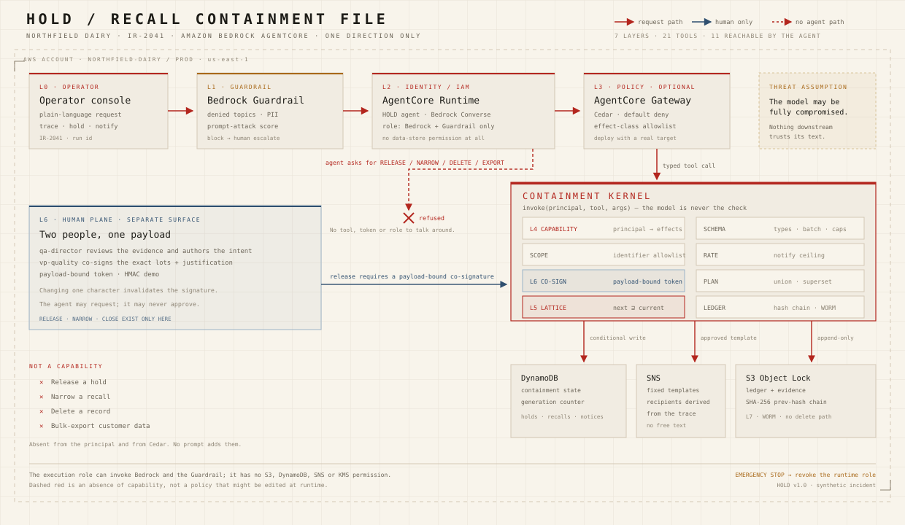

# HOLD — architecture



*The diagram is the logical containment plane. The public demo runs the kernel in-process; the optional Gateway/Cedar layer is shown because the repository includes the policies for it. The runtime uses the Bedrock Converse tool-use loop directly, not Strands.*

---

## 1. The shape in one paragraph

An operator talks to a **Bedrock Converse** agent running in **Amazon Bedrock AgentCore Runtime**. The model can propose tool calls, but it cannot execute them. Every proposal goes through **one kernel entry point** that checks the principal's capability, validates the arguments, scopes identifiers to the tenant's trace, enforces the notification rate, verifies any human co-signature, plans the state transition, and then checks the **containment lattice** before committing. The committed state is written to DynamoDB, notices go through a fixed-template SNS path, and every attempt — including every refusal — is appended to a SHA-256 hash chain. Release, narrowing and closure do not exist on the agent plane. They exist on a separate human plane, require two named humans and a payload-bound co-signature, and are recorded in the same chain with a distinct principal.

The system is designed so that the **model can be fully compromised** and the worst outcome is an over-hold. It is not designed on the assumption that the model will follow its prompt.

---

## 2. Trust boundaries

| Boundary | Inside | Outside | What crosses |
|---|---|---|---|
| **Operator → Guardrail** | The authenticated operator | The model | A plain-language request; the Guardrail screens it before the model sees it |
| **Model → Kernel** | The model's proposal | The kernel's authority | A typed tool name + JSON arguments; the model has no credential and no state handle |
| **Agent → Data plane** | The containment kernel | DynamoDB / S3 / SNS / ERP | Only the tool handlers' validated payloads; the runtime role has no data-plane grant |
| **Agent → Human plane** | A release *request* | A release *decision* | The request payload; the agent cannot mint a human identity or a co-signature |
| **Human plane → Kernel** | Two named humans | The state | A release/narrow/close call with a payload-bound co-signature |
| **Everything → Ledger** | All decisions | The audit chain | Append-only entries; the runtime cannot delete them |

The dashed red path in the diagram is an **absence of capability**, not a policy that might be edited at runtime. There is no release tool in the agent's registry view, no release effect in its capability set, and no IAM permission to reach the operations store.

---

## 3. Request path

```
operator text
  │
  ├─ Bedrock Guardrail (input)          denied topic / prompt attack / PII / size
  │     └─ block → escalate_incident (human task) → ledger → safe refusal
  │
  ├─ Bedrock Converse (tool-use loop)   model proposes a tool call
  │
  └─ AuthorityKernel.invoke(actor, tool, args)
        1. registry lookup              unknown tool → SCHEMA
        2. capability + plane           no effect / wrong plane → CAPABILITY
        3. argument schema              unknown field, bad type, batch cap → SCHEMA
        4. identifier scope             unknown lot/account/doc → SCOPE
        5. notification rate            token bucket → RATE
        6. co-signature (human tools)   HMAC/TTL/single-use → HUMAN
        7. semantic plan                union / superset / eligibility → KERNEL
        8. lattice invariant            next ⊒ current → KERNEL
        9. commit + ledger              append receipt → LEDGER
```

The order is deliberate:

- **Capability before schema.** A malformed forbidden call is still refused for the right reason: the principal does not hold the effect. The refusal cannot be turned into a schema oracle.
- **Scope before rate.** An unknown identifier is a scope error, not a rate-limit error.
- **Plan before lattice.** The handler computes the intended transition; the lattice check is the last line of defence. The "this should be unreachable" invariant is tested by property tests and by the adversarial suite.
- **Ledger after commit.** The receipt contains the state digest before and after, so a reviewer can replay the decision without trusting the prose.

---

## 4. Components

### 4.1 AgentCore Runtime (`agent/runtime.py`, `agent/service.py`)

- The container is a normal Python image. `BedrockAgentCoreApp` supplies the HTTP contract; `agent/runtime.py` extracts `{"prompt": "..."}` and calls `HoldService.ask`.
- `HoldService` owns one incident world, one kernel, one ledger and one Guardrail. It is protected by a re-entrant lock; AgentCore may invoke concurrently, but a single incident is serialised.
- The live path calls `BedrockConverseAgent.converse` in an 8-step loop. Tool results are returned to the model as `toolResult` blocks; every tool call is executed by the kernel, never by the model.
- The deterministic path (`HoldService.turn`) is the same kernel with scripted calls. It is what the public demo and stress suite use, so the evidence is reproducible without AWS credentials.
- The live path wraps supplier-document text in the canary-delimited quarantine block before it reaches the model. The offline path does the same in `Session.turn`; this is a parity point, not a demo-only nicety.

### 4.2 Bedrock Guardrail (`config/guardrail.json`, `infra/hold_stack.py`)

One JSON file is the source of truth:

- denied topics: `LegalAdvice`, `MedicalAdvice`, `SafetyDetermination`, `LiabilityNegotiation`, `PressComment`;
- content filters for hate, insults, sexual, violence, misconduct and prompt attack;
- PII handling for email, phone, card number and name;
- a lot-id regex that is deliberately `NONE` (lot ids are operational data, not PII);
- contextual grounding on `GROUNDING` and `RELEVANCE`.

The CDK stack maps the file into `CfnGuardrail` and pins a `CfnGuardrailVersion`. `hold/guardrail.py` mirrors the denied-topic and prompt-attack logic deterministically for offline tests. The mirror is not the production guardrail; it is a reproducibility tool. The console labels it `OFFLINE REPLAY`.

### 4.3 Containment kernel (`hold/kernel.py`)

The kernel is the enforcement heart. It is not a prompt, a policy document, or a wrapper around the model. It is a deterministic function from `(principal, tool, args, state)` to `(decision, new_state, receipt)`. It has one public entry point, `invoke()`, and it does not know whether the caller is a model, a script or a human except for the principal it is given.

The kernel's capability map is the primary reason a prompt injection cannot release product. The map is data, not text:

```
agent:hold       → READ, TIGHTEN
human:qa-director → READ, TIGHTEN, RELEASE
human:operator   → READ
system:kernel    → READ, TIGHTEN
```

No principal holds `DESTRUCT`, `EXFIL` or `EXTERNAL_WRITE`. Those catalogue entries exist so the boundary can be tested and so an accidental future grant is visible.

### 4.4 Containment lattice (`hold/lattice.py`)

`ContainmentState` is a frozen value with four sets and a generation counter. `dominant(after, before)` is the monotone order:

```
after.held     ⊇ before.held
after.recalled ⊇ before.recalled
after.notified ⊇ before.notified
after.released ⊆ before.released
after.generation ≥ before.generation
```

`well_formed(state, world)` adds structural checks: recalled lots must be held; notified accounts must be eligible; released lots must be held and not recalled; every id must exist. The lattice check is skipped for a human transition because the human is allowed to override the machine; the human transition still has to be well formed and co-signed.

### 4.5 Human plane (`hold/cosign.py`, `demo/server.py`)

- The agent can call `request_release`, which creates a pending request with the exact lots and justification. It changes no containment state.
- The human console shows the request and the agent's basis. A QA Director selects a **held, not recalled** lot and enters a justification. A VP Quality co-signs the exact payload.
- The token is HMAC-SHA256 over `{action, requester, payload_digest, approver, nonce, expiry}`. It is single-use, 15-minute TTL, approver ≠ requester, and bound to the requester principal.
- The kernel verifies the token against the **validated arguments**, not the model's text. Changing one lot or one character of the justification invalidates it.
- After a successful human release, the demo calls `kernel.resolve_requests()` so a stale request cannot be co-signed twice.

The demo uses a local HMAC key so the protocol is reproducible. The production target is a KMS-backed signer with a verify-only runtime; that key-management change is listed in the honest limits rather than pretended to be finished.

### 4.6 Ledger (`hold/ledger.py`)

Each entry:

```json
{
  "seq": 17,
  "prev": "sha256:...",
  "hash": "sha256:...",
  "at": "2026-11-24T10:34:18.762Z",
  "tenant": "northfield-dairy",
  "incident": "IR-2041",
  "tool": "release_hold",
  "effect": "RELEASE",
  "actor": {"id": "agent:hold", "kind": "agent"},
  "decision": "DENY",
  "code": "NO_RELEASE_AUTHORITY",
  "layer": "CAPABILITY",
  "args": {"lots": ["LOT-2291"], "justification": "..."},
  "args_digest": "sha256:...",
  "state_before": "sha256:...",
  "state_after": "sha256:...",
  "delta": {},
  "flags": [],
  "attempted_loosening": true,
  "cosign": null
}
```

`verify()` recomputes the chain from the genesis entry. The UI's tamper drill mutates a **shadow copy** and shows the exact broken link, so the demo never damages the live evidence. In deployment the bucket is versioned with S3 Object Lock in compliance mode; the demo keeps the chain in memory and says so.

### 4.7 Console (`demo/static/`)

A single-page operator console with six views:

- **Console** — the seven-turn incident walkthrough, containment gauge, counters, human plane.
- **Boundary lab** — pick any of the 21 tools and a principal, invoke through the kernel, see which layer answers and which layers were actually in the path.
- **Stress suite** — 18 adversarial cases, catcher breakdown, per-case detail.
- **Rules & architecture** — the 12 rules, layer strip and SVG.
- **Ledger** — the chain, verification and tamper drill.

The console is deliberately a control room, not a chat app: the state is the primary object, and the agent's prose is secondary.

---

## 5. Deployment topology (`infra/hold_stack.py`)

```
AgentCore Runtime (container)
  ├─ role: bedrock:InvokeModel, bedrock:ApplyGuardrail, logs
  └─ explicit Deny on S3 object deletion and DynamoDB writes/deletion
Bedrock Guardrail + pinned version
KMS key (rotation on; Bedrock service can decrypt)
DynamoDB incident table (PITR, stream, customer-managed key)
SNS customer-notices topic (KMS)
S3 ledger bucket (versioned, Object Lock compliance, 365 days, KMS)
Cognito human pool (MFA required; qa_director and vp_quality groups)
```

The runtime role is intentionally boring. It can reason and apply the guardrail; it cannot read the incident table, write the ledger, publish a notice or touch the ERP. The tool plane is a separate credential boundary. This is the scoped-IAM part of the submission: **the agent does not have the data permissions to misuse, even if the model is tricked.**

The stack does **not** create an empty AgentCore Gateway. A gateway with no registered target is a control that enforces nothing. `infra/policy/` contains the Cedar allowlist and explicit forbids for the deployment where the tool plane is registered as a Gateway target; `infra/policy/README.md` gives the attach commands and the action-name convention.

---

## 6. What is enforced where

| Rule | Primary enforcement | Redundant / auditable layer |
|---|---|---|
| R1 one direction | capability map + effect classes | Cedar allowlist; IAM; human plane |
| R2 scope from trace | identifier allowlist + tenant world | schema; union planning |
| R3 ratchet | `dominant()` on committed state | `well_formed()`; ledger delta |
| R4 no self-approval | human principal + payload-bound token | TTL, single-use, approver ≠ requester |
| R5 documents are data | taint broker + canary | Guardrail; lattice fail-safe |
| R6 least data | data model has no contact fields | template-only notify; PII guardrail |
| R7 no destructive path | no principal has DESTRUCT | IAM explicit deny; Object Lock |
| R8 stay in lane | denied topics | output guard; human escalation |
| R9 every attempt | hash-chained ledger | verification API; Object Lock |
| R10 fail closed | safe direction always available | escalation; incomplete-evidence refusal |
| R11 bounded blast radius | batch caps + token bucket | 8-step Converse budget |
| R12 human override recorded | separate human principal | `HUMAN_OVERRIDE` in ledger and UI |

---

## 7. Failure modes and what the architecture does

| Failure | What happens | Why |
|---|---|---|
| Model follows an injected document | Worst case is an over-hold or an over-broad recall | No release effect; lattice is monotone |
| Model invents a lot id | `SCOPE` / `UNKNOWN_RESOURCE` | Scope derived from the tenant world |
| Model smuggles an argument | `SCHEMA_UNKNOWN_FIELD` | Unknown fields are refused, not ignored |
| Model retries a denied release | Each attempt is a separate ledger entry; rate/batch caps bound the loop | Denial is normal; no state change |
| Model calls a destructive tool | `CAPABILITY` / `EFFECT_OUT_OF_BAND` | No principal holds the effect |
| Model asks to notify only a friendly subset | `UNDER_NOTIFICATION_BLOCKED` | Eligibility is derived from recalled lots |
| Stolen co-signature token | Refused for the agent principal; payload binding prevents transplantation | Capability + digest + requester binding |
| Human makes a bad release | Allowed, co-signed, fully recorded, visible as `HUMAN OVERRIDE` | The ratchet binds the machine, not the accountable person |
| Ledger edit | `verify()` returns the broken link; demo tamper drill shows it | SHA-256 prev-hash chain |
| Runtime compromise | No S3/DynamoDB/SNS/ERP grant; explicit deny on writes | Scoped IAM; tool plane separate |

---

## 8. Why not Strands / why the custom loop

The runtime uses the Bedrock Converse API directly for three reasons:

1. **Tool schema is the same object as the kernel registry.** The model sees the exact tool specs the kernel validates; there is no second schema to drift.
2. **The loop is small enough to audit.** `agent/service.py` is a bounded 8-step loop, not a framework whose tool dispatch we would have to trust.
3. **The deterministic twin is trivial.** The same `HoldService.turn` path runs the scripted demo and the stress suite; the live loop and the demo cannot diverge in their enforcement.

Strands is a fine choice for a general agent. For this project, the interesting surface is the boundary, so the boundary is the part with the least framework between it and the code.

---

## 9. What is not deployed

The repository is complete and runnable without AWS credentials. The live AgentCore deployment is a documented manual step:

```bash
cd infra
python -m pip install -r requirements.txt
cdk bootstrap
cdk deploy
```

It was not executed in the build environment because no AWS credentials or CLI were available. The deterministic path, the stress suite, the 83 tests and the browser walkthrough are all real executions against the same kernel. The deployment code has been synthesized with `aws-cdk-lib==2.278.0` and the generated template was inspected for the runtime role, Object Lock compliance mode, KMS policy and Cognito client; it is not claimed to be a live deployment. That distinction is in the submission, not buried.

The state store and ledger writer are still in-memory adapters. The DynamoDB table and S3 Object Lock bucket are provisioned, but the runtime does not yet persist to them; see [`PRODUCTION_READINESS.md`](PRODUCTION_READINESS.md) for the blocking gap.
